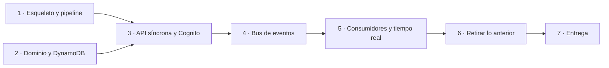

# Roadmap: migración a serverless + Terraform + GitHub Actions

Plan para llegar a la entrega del TP3 partiendo del sistema actual (Spring Boot + PostgreSQL,
desplegado a mano) y terminando en la arquitectura de
[arquitectura-serverless.md](arquitectura-serverless.md), desplegada con Terraform desde un pipeline
de GitHub Actions.

---

## Cómo se evalúa

| Criterio de la rúbrica | Peso | Qué significa para nosotros | Dónde |
|---|---|---|---|
| Correcta implementación y uso de módulos | **20 %** | Módulos propios con una responsabilidad clara, reutilizados de verdad, con la estructura que pide la clase 10 | [Módulos](#módulos) |
| Usan un módulo externo | **10 %** | Uno del Registry, con la versión fijada y usado con sentido | [Módulos](#módulos) |
| Usan correctamente 4 funciones y 3 meta-argumentos | 5 % | Cada uno con un motivo que se pueda explicar, no puesto para cumplir | [Requisitos](#requisitos-de-terraform-y-dónde-se-cumplen) |
| Calidad de código Terraform | **10 %** | Formato, validación, linter, variables tipadas y documentadas, nada escrito a mano | [Calidad](#calidad-de-código) |
| Correcto uso de locals y datasources | 5 % | Locals para lo que se deriva; datasources para lo que no administramos | [Requisitos](#requisitos-de-terraform-y-dónde-se-cumplen) |
| Claridad del README | **10 %** | Módulos, funciones, meta-argumentos y una guía que la cátedra pueda seguir sin preguntarnos | Fase 7 |
| Despliegue correcto de la arquitectura | **20 %** | El pipeline crea **todo**, en una cuenta que no es la nuestra, sin pasos a mano | Fases 1, 3 a 5 |
| El TP funciona correctamente | **20 %** | La app desplegada se puede usar de punta a punta | Fases 3 a 5 |

Tres conclusiones que ordenan todo el plan:

1. **El 40 % es que se despliegue y funcione.** La reescritura del backend no suma puntos por sí
   misma: es un costo que tiene que terminar en algo que funciona. Como no hay un plan B, la defensa
   es el orden: un esqueleto desplegado desde la Fase 1, cada fase desplegada por el pipeline antes de
   darla por terminada, y una [lista de recortes](#si-el-tiempo-no-alcanza) decidida de antemano.
2. **El 30 % son módulos.** Se diseñan antes de escribir los recursos, no se extraen al final.
3. **Lo que la consigna exige sin estar en la rúbrica** (pipeline en el PR, correcciones del TP2,
   diagrama) es condición para aprobar y probablemente pese dentro de "despliegue correcto". No se
   recorta.

### Lo que además pide la consigna

| Pedido | Dónde |
|---|---|
| "Implementar la arquitectura diseñada" | Cambiamos el diseño del TP2: el README explica la evolución y el diagrama la refleja (Fase 7) |
| Correcciones del TP2 implementadas | [Ajustes al diseño](#ajustes-al-diseño) |
| Variables y outputs para parametrizar | Fase 1 en adelante |
| Organización lógica, nomenclatura consistente, DRY | [Calidad](#calidad-de-código) |
| Pipeline con init, validate, plan, apply y destroy, **que se ejecute correctamente en el pull request** | Fase 1. El ciclo completo tiene que poder correrse desde el PR, que probablemente no se mergee antes de la corrección |
| El pipeline documentado en el README | Fase 7 |
| Diagrama actualizado y alineado con el código | Fase 7 |
| PR al repositorio de la cátedra y hash del commit en el campus | Fase 7 |
| Se permiten datos simulados | Datos de demo en la Fase 3 |

**La cátedra tiene que poder correrlo**, y la consigna lo marca como crítico. Eso descarta valores
fijos de nuestra cuenta, pasos manuales fuera del README y cualquier recurso que no se pueda destruir.

---

## Decisiones tomadas

| Decisión | Elegido | Consecuencia |
|---|---|---|
| Autenticación del staff | **Cognito** | La API REST valida el token con un authorizer de Cognito, sin ejecutar ninguna Lambda. Desaparecen el login propio, BCrypt, la Lambda authorizer y el secreto del JWT |
| Canales de aviso | **Solo SES** | Sin Web Push: sin service worker ni claves VAPID. En el sandbox de SES los emails llegan solo a direcciones verificadas, alcanza con las del grupo |
| Origen del PR | **Una rama en el repositorio de la cátedra** | Ahí se cargan los secrets, y el workflow del PR los recibe. Desde un fork no los recibiría |
| Punto de control | **No hay** | Se va con serverless hasta el final. El riesgo se maneja con el orden de las fases y la lista de recortes |

Con Cognito y SES **no queda ningún secreto que guardar**: DynamoDB, SES, SNS y SQS se autentican con
IAM. Secrets Manager sale del diseño.

---

## Ajustes al diseño

`arquitectura-serverless.md` es la base, con estos cambios:

| # | Ajuste | Motivo |
|---|---|---|
| 1 | Despliegue con **Terraform y GitHub Actions**, no con SAM ni desde la máquina local | Lo exige la consigna |
| 2 | **Ningún secreto en texto plano**, y en la práctica ningún secreto: Cognito reemplaza el JWT propio y todo lo demás se autentica con IAM | Corrección del TP2: "falta encriptar", por las contraseñas de `app.env` subidas en texto plano |
| 3 | **Tres buckets privados:** `spa`, `artefactos` (zips de las Lambdas) y `logs` (access logs de los otros dos) | Corrección del TP2: "separaría el bucket privado en 3" |
| 4 | **Justificar en el README por qué no hay VPC** | El corrector elogió la parte de red; su ausencia tiene que leerse como una decisión |
| 5 | **Las métricas históricas quedan fuera de esta entrega** (Firehose, el data lake, Glue y Athena). Se mencionan en el README como trabajo futuro. Tampoco X-Ray, que no se vio en clase | Recorta alcance. Las métricas del día ya salen de los ítems `F#` |
| 6 | CloudFront figura como **bloqueado por el lab**, no como decisión del equipo | Es lo que pasó en el TP2, y es mejor argumento |
| 7 | Un recurso de API Gateway **por página** del sitio, más `binaryMediaTypes` | Con `trailingSlash: true`, `/login/` es `login/index.html`, y la integración con S3 no agrega `index.html` sola. Sin `binaryMediaTypes`, las fuentes y las imágenes llegan rotas |
| 8 | **Cognito en lugar de la autenticación propia**, y **sin Web Push** | [Decisiones tomadas](#decisiones-tomadas) |

---

## Módulos

Pesan el 30 % de la nota, así que se definen antes de escribir recursos.

### Propios

Cada uno con la estructura de la clase 10: `main.tf`, `variables.tf`, `outputs.tf`, `versions.tf` y
`README.md`. Un módulo que se usa una sola vez y solo envuelve un recurso no suma: cada uno de estos
**encapsula una decisión** y se usa varias veces.

| Módulo | Qué encapsula | Se usa para |
|---|---|---|
| `private-bucket` | Bucket con bloqueo de acceso público, versionado, política que exige TLS, logs de acceso y expiración opcional | `spa`, `artefactos`, `logs` |
| `lambda-function` | Función con `LabRole`, alias `live`, log group con retención, SnapStart opcional y variables de entorno | Las 7 funciones |
| `queue-with-dlq` | Cola SQS (standard o FIFO) con su DLQ, la política de redrive y la alarma de profundidad > 0 | `q-push`, `q-notifications`, `q-lifecycle` |

`queue-with-dlq` es el que mejor muestra DRY: sin él, cada cola son cuatro recursos repetidos tres
veces, y es fácil olvidarse la alarma en una.

### Externo

**`terraform-aws-modules/dynamodb-table/aws`**, con la versión fijada, para `q-main` y
`q-connections`. Se usa dos veces, cubre todo lo que necesitamos (Streams, GSI, TTL, PITR) y **no crea
roles de IAM**, que en el lab fallarían.

Descartados: `terraform-aws-modules/lambda/aws` crea un rol por defecto y empaqueta por su cuenta, lo
que choca con nuestro propio módulo; `terraform-aws-modules/vpc/aws` ya no aplica porque no hay VPC.

---

## Fase 1 · Esqueleto que camina: Terraform y pipeline

**Va primero a propósito:** si el pipeline existe desde el principio, cada fase posterior se
despliega por el mismo camino que va a usar la cátedra, y los problemas del lab aparecen temprano.

**No es solo infraestructura base.** El esqueleto atraviesa todas las capas con lo mínimo: el sitio
servido por API Gateway, una Lambda Java que lee y escribe una tabla, y el pipeline que lo despliega.
Así se prueban temprano las piezas con más riesgo (la integración con S3, SnapStart, `LabRole`) y lo
que se evalúa en el TP3 existe y funciona desde el principio.

Solo entran recursos cuyo diseño no va a cambiar. Las claves de la tabla, las rutas reales y las
colas se agregan en las fases que las definen.

### Estructura

```
infra/terraform/
├── versions.tf          terraform >= 1.10, provider aws ~> 6.0
├── backend.tf           S3, use_lockfile = true (lo completa el pipeline con -backend-config)
├── providers.tf         región, default_tags
├── data.tf              todos los datasources
├── locals.tf            nombres, tags, mapas de funciones, colas y páginas
├── variables.tf · outputs.tf · terraform.tfvars.example
├── auth.tf              Cognito: user pool y cliente (Fase 3)
├── storage.tf           module "private_bucket" con for_each
├── tables.tf            module externo de DynamoDB (Fase 2)
├── api.tf               API REST y sitio (Fases 1 y 3)
├── events.tf            Streams, SNS, module "queue_with_dlq" (Fase 4)
├── realtime.tf          API WebSocket (Fase 5)
├── monitoring.tf        SNS q-alerts y su suscripción
├── seed.tf              datos de demo (Fase 3)
├── seed/demo.json
├── lambdas/             el código Node (ws-connections)
└── modules/
    ├── private-bucket/
    ├── lambda-function/
    └── queue-with-dlq/
```

### Tareas

- [ ] Estructura de arriba, con `fmt`, `validate` y `tflint` pasando.
- [ ] `.terraform.lock.hcl` commiteado, para que la cátedra use las mismas versiones de providers.
- [ ] `data "aws_iam_role" "lab"`: todo usa `LabRole`, no se crea ningún rol.
- [ ] Nombres derivados de la cuenta y la región (datasources), nunca escritos a mano.
- [ ] Módulo `private-bucket` con los tres buckets, y `force_destroy` para que `destroy` funcione
      con objetos adentro.
- [ ] Módulo `lambda-function` usado por una Lambda Java mínima (`GET /api/v1/health`) que escribe y
      lee un ítem de una tabla de prueba, con SnapStart y alias `live`. Si el runtime `java25` o
      SnapStart no están disponibles, se resuelve acá: Java 21, o más memoria sin SnapStart.
- [ ] API REST con stage `prod` sirviendo el build actual del frontend desde `spa`, con una ruta por
      página y `binaryMediaTypes`. Si `LabRole` no puede leer S3 desde API Gateway, el plan B es una
      Lambda Node mínima que sirva los archivos.
- [ ] Anotar el límite de concurrencia de Lambda de la cuenta
      (`aws lambda get-account-settings --query AccountLimit.ConcurrentExecutions`). Si es menor que
      10, `notifier` y `lifecycle` se unen en una sola función.
- [ ] `.github/workflows/terraform.yml`:
  - Job **`validate`**, sin credenciales: `fmt -check`, `init -backend=false`, `validate` y
    `tflint`. Siempre tiene que poder correr, aunque el lab esté vencido.
  - Job **`plan`** en cada PR: credenciales del lab, `init` con el backend, `plan`, y el plan como
    comentario en el PR.
  - Job **`apply`** en el PR, después del `plan`, detrás de un *environment* con aprobación manual,
    para que no despliegue con cada push. Lo tiene que poder disparar la cátedra.
  - **`destroy`** por dos caminos: agregarle la etiqueta `destroy` al PR (dispara el workflow con
    `pull_request: types: [labeled]`), y `workflow_dispatch`. Los dos detrás del mismo
    *environment*.
  - Por qué no alcanza con `workflow_dispatch`: GitHub solo lo muestra cuando el workflow ya está en
    la rama por defecto, y el PR de la entrega probablemente no se mergee antes de la corrección.
    Todo el ciclo tiene que poder correrse desde el PR.
  - Un paso previo que crea el bucket `tfstate-<cuenta>` si no existe.
  - Después de `apply`, una **prueba de humo**: `curl` a la URL del sitio y a `/api/v1/health`. Si
    falla, el job falla. Es la evidencia de "despliegue correcto".
- [ ] Secrets en el repositorio de la cátedra: `AWS_ACCESS_KEY_ID`, `AWS_SECRET_ACCESS_KEY`,
      `AWS_SESSION_TOKEN`. Vencen con la sesión del lab: hay que actualizarlos cada vez que se inicia.

**Listo cuando:** en un PR de prueba, `validate` y `plan` corren solos; al aprobar, `apply` despliega
y la prueba de humo pasa; y la etiqueta `destroy` deja la cuenta limpia.

---

## Fase 2 · Dominio y persistencia en DynamoDB

Puede empezar en paralelo con la Fase 1.

### Separar el dominio de Spring

- [ ] Convertir `backend/` en un proyecto Maven multimódulo, como en §4.5 del documento, sin los
      módulos de autenticación propia.
- [ ] Mover a `q-domain` la lógica pura que hoy está en `service/`: `QueueOrdering`,
      `QueueEntrySelector`, `EstimationService`, las políticas de no-show, el cálculo de métricas y
      las vistas. **Sin Spring, sin JPA y sin AWS.**
- [ ] Reemplazar los enteros separados de a 1000 por **claves de orden fraccionarias**.
- [ ] Llevar los tests de esas clases a `q-domain`. Son unitarios: no necesitan base.

### Persistencia

- [ ] Terraform: `q-main` (on-demand, Streams `NEW_AND_OLD_IMAGES`, PITR) y `q-connections`
      (GSI `byQueue`, TTL), con el módulo externo.
- [ ] `q-dynamo`: repositorios con el Enhanced Client del SDK v2, según el modelo de §5.1, **sin**
      los ítems `USER#/PROFILE` ni `EMAIL#`: los usuarios viven en Cognito. Las membresías se guardan
      por el `sub` de Cognito.
- [ ] Control optimista con `version` en `META`, reintentos con backoff y jitter, y `409` al
      agotarlos (§6.1).
- [ ] El ítem de evento dentro de cada transacción (§6.2).
- [ ] Ítems de búsqueda `TICKET#` y `USER#/EST#`, leídos con lectura fuerte.
- [ ] Tests de integración con **DynamoDB Local** en Testcontainers. Tienen que cubrir las cuatro
      carreras de §6.1, en particular dos personas del staff llamando a la vez.

**Listo cuando:** `q-domain` compila solo, las operaciones corren contra DynamoDB Local y las
carreras están cubiertas por tests.

---

## Fase 3 · API síncrona y Cognito

- [ ] Terraform: user pool de Cognito con verificación de email y su cliente (sin secreto de
      cliente, porque lo usa el navegador).
- [ ] Handlers `q-fn-public` y `q-fn-staff`, sin Spring, con inyección manual de dependencias.
      `staff` toma el usuario del token que ya validó API Gateway.
- [ ] Terraform: rutas de la API REST.
  - `/api/v1/public/*` → `λ public`, sin authorizer.
  - `/api/v1/*` → `λ staff`, con el **authorizer de Cognito**.
  - Validación del body con JSON Schema y *throttling* por método.
  - Se eliminan la Lambda y la tabla de prueba de la Fase 1.
- [ ] Límite por IP en `λ public` (§3.1).
- [ ] Frontend:
  - `basePath: '/prod'` y las URLs, el id del user pool y el del cliente leídos de `config.json`,
    que escribe Terraform;
  - login y registro contra Cognito, manteniendo las páginas actuales (sin el Hosted UI, así no
    hace falta la Lambda puente para el redirect por HTTPS).
- [ ] **Datos de demo** (la consigna los permite): un establecimiento, dos colas con carriles, sus
      ítems de membresía y un usuario de staff en Cognito, cargados desde `seed/demo.json`. Se activan
      con `var.cargar_demo`. La contraseña del usuario la genera `random_password` y sale como output
      sensible.
- [ ] **Outputs para la cátedra:** URL del sitio, URL de la cola de demo (la del QR) y el usuario y
      la contraseña de staff (`terraform output -raw contrasena_demo`).
- [ ] La prueba de humo del pipeline pasa a anotarse en la cola de demo.

**Listo cuando:** desde la URL que imprime `terraform output` se puede entrar como staff, unirse como
cliente y llamar, todo desplegado por el pipeline. Sin tiempo real todavía.

---

## Fase 4 · Bus de eventos

- [ ] `λ stream-publisher`: filtra solo los `INSERT` de `QUEUE#*#EV`, con
      `BisectBatchOnFunctionError` y destino de fallas.
- [ ] SNS FIFO `q-queue-events` (`MessageGroupId = queueId`, deduplicación por `eventId`).
- [ ] Las tres colas con el módulo `queue-with-dlq`: `q-push` (FIFO), `q-notifications` (standard,
      con filtro por `type`) y `q-lifecycle` (standard).
- [ ] `MaximumConcurrency` en cada consumidor, según el presupuesto de §9.
- [ ] Alarma de edad del mensaje más viejo de `q-push` mayor a 10 s. Todas las alarmas avisan a SNS
      `q-alerts`.

**Listo cuando:** una acción en la API deja su evento en las tres colas, y un mensaje que falla
siempre termina en la DLQ y dispara la alarma.

---

## Fase 5 · Consumidores y tiempo real

- [ ] API WebSocket con `$connect`, `subscribe`, `$disconnect` y `ping` con integración *mock*.
- [ ] `λ ws-connections` en Node, con el ticket de un solo uso para el staff (§3.2). El ticket lo
      emite `λ staff` a un usuario autenticado por Cognito.
- [ ] `λ broadcaster`: lee la cola una vez por lote, arma las vistas y las empuja; borra la
      conexión ante `410 Gone`.
- [ ] `λ notifier`: deduplica con `NOTIF#type#cycle` y envía por SES en el idioma del cliente. Un
      rechazo por destinatario no verificado se registra como envío simulado y no se reintenta.
- [ ] SES: la identidad del remitente en Terraform, y los emails del grupo verificados para probar.
- [ ] `λ lifecycle`: vencimiento de gracia con condición sobre `status` y `cycle`, y cierre de
      colas en lotes de 30.
- [ ] Frontend: `useLiveResource` pasa de SSE a WebSocket y conserva la carga inicial por REST y el
      polling de respaldo.

**Listo cuando:** el tablero del staff y la página del cliente se actualizan solos, la gracia vence
sin que nadie mire la cola, y llegan los emails a direcciones verificadas.

---

## Fase 6 · Retirar lo anterior

- [ ] Sacar Spring Boot, JPA, Flyway, PostgreSQL y la autenticación propia del backend.
- [ ] Sacar el `Dockerfile` del backend y el servicio de systemd.
- [ ] Reemplazar `docker-compose.yml` por DynamoDB Local para desarrollo.
- [ ] Borrar el `app.env` del bucket de artefactos del TP2 y **revocar la contraseña de aplicación de
      Gmail** que estaba adentro: estuvo en texto plano en S3.
- [ ] Borrar `infra/q-stack.yaml` y `infra/q-architecture.drawio`, o moverlos a una carpeta de
      historial del TP2.
- [ ] Actualizar `docs/architecture.md`, `docs/deployment.md` y el README principal.

**Listo cuando:** no queda nada en el repo que describa el despliegue anterior como vigente.

---

## Fase 7 · Entrega

- [ ] **README de `infra/terraform/`**, pensado para alguien que no nos conoce:
  - **evolución desde el TP2:** qué cambió de la arquitectura y por qué, como pedía la segunda
    entrega;
  - qué hace cada módulo, sus entradas y salidas, y por qué es propio o externo;
  - cada función, cada meta-argumento, cada local y cada datasource, con el archivo y la línea, y
    el motivo de usarlo ahí;
  - el pipeline: qué corre en cada evento, cómo aprobar el `apply` y cómo destruir;
  - guía paso a paso para la cátedra: requisitos, cómo cargar las credenciales del lab en los
    secrets, cómo correr el pipeline, qué outputs mirar, cómo probar la app y cómo destruir;
  - por qué no hay VPC;
  - trabajo futuro: métricas históricas con Firehose, S3, Glue y Athena;
  - cómo se aplicó cada corrección del TP2, en particular dónde quedó cada valor que estaba en
    `app.env` y por qué ya no hay secretos.
- [ ] Un `README.md` por módulo.
- [ ] Diagrama actualizado, generado o revisado contra el código de Terraform.
- [ ] **Ensayo de la cátedra:** alguien del grupo que no haya tocado el Terraform sigue solo el
      README, en su propia cuenta del lab: `apply`, usar la app, `destroy`, y otro `apply`. Cada
      paso donde tenga que preguntar es un arreglo del README.
- [ ] PR desde una rama del repositorio de la cátedra, con el pipeline en verde y el hash del commit
      en el campus.

---

## Requisitos de Terraform y dónde se cumplen

| Requisito | Uso previsto |
|---|---|
| Módulos propios | `private-bucket` ×3, `lambda-function` ×7, `queue-with-dlq` ×3 |
| Módulo externo | `terraform-aws-modules/dynamodb-table/aws` ×2, con la versión fijada |
| `for_each` | buckets, Lambdas, colas, páginas del sitio, archivos del sitio, ítems de demo |
| `count` | suscripción por email a `q-alerts`, solo si se pasa `var.email_alertas`. Los datos de demo no: usan `for_each` sobre un mapa que queda vacío si `var.cargar_demo` es `false`, porque un recurso no puede tener `count` y `for_each` a la vez |
| `depends_on` | `aws_api_gateway_deployment` sobre los métodos y las integraciones: el deployment toma una foto de la API y Terraform no ve que la necesita completa |
| `lifecycle` | `create_before_destroy` en el deployment de API Gateway, para que el stage nunca quede apuntando a nada; `replace_triggered_by` para redesplegar cuando cambia la configuración de la API |
| Funciones | `jsonencode()` (políticas, JSON Schemas, filtros de SNS, `config.json`) · `jsondecode()` + `file()` (datos de demo) · `fileset()` + `lookup()` + `filemd5()` (subir el sitio con el content-type y el etag correctos) · `sha1()` (disparador del redeploy de la API) · `merge()` (tags) · `format()` (nombres) |
| Locals | prefijo de nombres y tags comunes; el mapa de Lambdas (runtime, memoria, timeout, disparador) que recorre el `for_each`; el mapa de colas; la lista de páginas del sitio; la tabla de tipos MIME |
| Datasources | `aws_caller_identity` y `aws_region` (nombres únicos en cualquier cuenta), `aws_iam_role` (`LabRole`), `aws_iam_policy_document` (políticas de buckets, colas y tópicos, en lugar de JSON a mano), `archive_file` (zips de las Lambdas Node) |

---

## Calidad de código

Es el 10 % de la nota y lo primero que ve quien abre el repositorio.

- [ ] `terraform fmt`, `validate` y `tflint` en el pipeline: un PR con errores no pasa.
- [ ] Cada variable con `type`, `description` y, donde aplica, un bloque `validation` (por ejemplo, la
      región o el formato de un email).
- [ ] Cada output con `description`, y `sensitive = true` en la contraseña de demo.
- [ ] Versiones fijadas: Terraform, el provider y el módulo externo.
- [ ] Ningún ID, ARN, número de cuenta ni nombre de bucket escrito a mano.
- [ ] Nombres de recursos en `snake_case` y nombres en AWS con un único prefijo (`local.prefix`).
- [ ] Un archivo por área, como en la estructura de la Fase 1.
- [ ] Las convenciones de *Terraform Best Practices*, que la consigna recomienda: `this` para el
      recurso principal de cada módulo, nombres sin repetir el tipo de recurso, `versions.tf` en cada
      módulo.
- [ ] Nada repetido: lo que se repite es un `for_each` sobre un local, o un módulo.

---

## Si el tiempo no alcanza

No hay un plan B de arquitectura, así que esta lista es la red de seguridad. En este orden, de lo
primero que se recorta a lo último:

1. SnapStart (Java con más memoria).
2. El límite por IP en `λ public` (queda el *throttling* de API Gateway).
3. El WebSocket: las pantallas quedan al día con el polling de respaldo, y se ahorran
   `ws-connections`, `broadcaster`, `q-push` y la API WebSocket.

**Lo que no se recorta:** el pipeline, los módulos, las correcciones del TP2, el README y que la
cátedra pueda correrlo.

---

## Dependencias entre fases



Las Fases 1 y 2 van en paralelo. A partir de la 3, cada fase se despliega por el pipeline antes de
darla por terminada.
