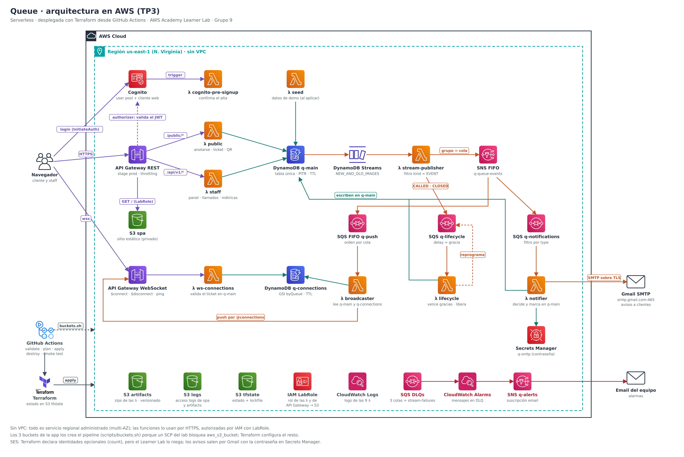

# Terraform de Queue — Tercera Entrega

Esta raíz implementa la arquitectura serverless de Queue. La entrada para ejecutar la entrega es
la [guía de despliegue](../../docs/deployment.md); este documento explica cómo está construida la
infraestructura y dónde se cumple cada requisito.

## Diagrama de arquitectura



Cada nodo es un recurso de esta configuración. El diagrama se genera desde código:
[`docs/diagrams/arquitectura.py`](../../docs/diagrams/arquitectura.py) escribe el SVG y
`node docs/diagrams/render.mjs` lo exporta a PNG. La [arquitectura](../../docs/architecture.md)
explica las decisiones detrás de cada conexión.

## Requisitos y evidencia

| Requisito | Implementación | Evidencia |
|---|---|---|
| Módulo propio | Tres módulos reutilizados | [Módulos](#módulos) |
| Módulo externo | DynamoDB, versión `5.5.2`, usado en dos tablas | [tables.tf](tables.tf) |
| Variables y outputs | Parámetros tipados, descripciones y outputs operativos | [Entradas y salidas](#entradas-y-salidas) |
| Cuatro funciones como mínimo | Serialización, lectura de archivos, nombres, hashes y colecciones | [Funciones](#funciones-terraform) |
| Tres meta-argumentos como mínimo | Se utilizan los cuatro de la consigna | [Meta-argumentos](#meta-argumentos) |
| Pipeline con init, validate, plan, apply y destroy | GitHub Actions sobre el PR, con aprobación del apply y smoke test | [Workflow](../../.github/workflows/terraform.yml) y [guía](../../docs/deployment.md) |
| Correcciones del TP2 | Buckets separados y tratamiento del secreto | [Evolución](#evolución-desde-el-tp2) |

## Versiones y estructura

El workflow instala Terraform `1.16.4`, tflint `v0.64.0` y Node `22`; las funciones requieren Node
`>=22.22`. La configuración admite Terraform `>=1.10.0, <2.0.0`, porque usa bloqueo nativo S3.
[versions.tf](versions.tf) restringe AWS a `~>6.67.0`, Archive a `~>2.8.0` y Random a `~>3.9.0`.
El [lockfile](.terraform.lock.hcl) fija las versiones resueltas y sus checksums: debe versionarse.
Los módulos locales declaran sus propios requisitos de providers; heredan el provider de la raíz.

| Archivos | Responsabilidad |
|---|---|
| `versions.tf`, `providers.tf`, `backend.tf` | Versiones, región, tags comunes y estado remoto |
| `variables.tf`, `outputs.tf`, `locals.tf`, `data.tf` | Interfaz pública, valores derivados y recursos existentes |
| `storage.tf`, `site.tf` | Configuración de buckets, objetos del sitio y `config.json` |
| `tables.tf` | Tablas principal y de conexiones |
| `functions.tf`, `auth.tf` | Lambdas, consumidores SQS, Cognito y permisos de invocación |
| `api.tf`, `openapi.tf`, `realtime.tf` | API REST, documento OpenAPI y API WebSocket |
| `events.tf`, `monitoring.tf`, `notifications.tf` | Bus, alarmas, identidades SES opcionales y secreto SMTP |
| `seed.tf`, `seed/demo.json` | Usuario y datos de demo opcionales |
| `modules/`, `scripts/buckets.sh` | Módulos propios y excepción de creación/borrado S3 |

## Módulos

| Módulo | Tipo y usos | Contrato y motivo |
|---|---|---|
| [lambda-function](modules/lambda-function/README.md) | Propio, nueve funciones: dos API, seis workers y pre-signup | Recibe bundle, rol, memoria, timeout, entorno y bucket; entrega nombre, ARN, ARN de integración, log group y hash del código. Agrupa empaquetado, objeto versionado, función y logs con retención. |
| [private-bucket](modules/private-bucket/README.md) | Propio, tres buckets de aplicación | Recibe el nombre de un bucket existente y opciones de versionado, logs, política y expiración; entrega nombre y ARN. Centraliza acceso privado y TLS. El pipeline crea y elimina el bucket. |
| [queue-with-dlq](modules/queue-with-dlq/README.md) | Propio, push, notifications y lifecycle | Recibe nombre, modo FIFO, visibilidad, retenciones, tópicos permitidos y destino de alarmas; entrega ARN, URL, nombre y referencias a la DLQ. Evita repetir redrive, permisos y alarmas. |
| [dynamodb-table/aws](https://registry.terraform.io/modules/terraform-aws-modules/dynamodb-table/aws/5.5.2) | Externo, `main_table` y `connections_table` | Recibe esquema de claves, índices, TTL, Streams y PITR; se consumen sus outputs de nombre y ARN del stream. Cubre ambas tablas sin crear roles IAM, restringidos en el lab. Versión exacta en `tables.tf`. |

El plan muestra un aviso de deprecación de `hash_key` que sale del módulo externo: la versión 5.5.2
todavía declara las claves de las tablas con ese argumento del provider 6.x. Es solo un aviso y no
cambia lo que se crea.

Los mapas de funciones API y workers están separados para evitar ciclos: la API REST depende de
sus funciones y algunos workers necesitan la URL de esa API. El trigger de Cognito se declara aparte
por una dependencia equivalente entre función y user pool. Esta separación es intencional.

## Funciones Terraform

Las expresiones siguientes son ejemplos del código vigente; los archivos enlazados son la referencia.

| Función | Ejemplo | Archivo y propósito |
|---|---|---|
| `jsonencode` | `jsonencode(local.openapi)` | [api.tf](api.tf): convertir el documento generado en el body de API Gateway. También políticas, filtros SNS y configuración del sitio. |
| `jsondecode` y `file` | `jsondecode(file("${path.module}/seed/demo.json"))` | [locals.tf](locals.tf): cargar datos de demo estructurados desde un archivo versionado. |
| `fileset` | `fileset(var.site_dir, "**")` | [locals.tf](locals.tf): descubrir objetos del build estático sin enumerarlos a mano. |
| `lookup` | `lookup(local.mime_types, lower(regex("[^.]+$", each.value)), "application/octet-stream")` | [site.tf](site.tf): resolver el MIME con un valor de respaldo. |
| `filemd5` | `filemd5("${var.site_dir}/${each.value}")` | [site.tf](site.tf): detectar cambios en el contenido de cada objeto. |
| `sha1` | `sha1(aws_api_gateway_rest_api.this.body)` | [api.tf](api.tf): renovar el deployment cuando cambia la definición REST. No se usa como mecanismo de seguridad. |
| `merge` | `merge(local.logged_bucket_names, { logs = format("%s-logs-%s", var.project, local.name_suffix) })` | [locals.tf](locals.tf): componer nombres de buckets sin repetir su regla. |
| `format` | `format("%s-main", var.project)` | [tables.tf](tables.tf): nomenclatura coherente a partir de un prefijo parametrizable. |
| `toset` y `distinct` | `toset(distinct([for route in values(local.api_routes) : route.function]))` | [api.tf](api.tf): un permiso de invocación por función, aunque atienda varias rutas. |
| `floor` y `coalesce` | `floor(coalesce(var.expiration_days, 0))` | [private-bucket/variables.tf](modules/private-bucket/variables.tf): validar días enteros y manejar el caso opcional nulo. |
| `try` | `try(aws_secretsmanager_secret.smtp[0].arn, "")` | [locals.tf](locals.tf): entorno válido cuando no se crea el secreto opcional. |
| `can` y `regex` | `can(regex("^[a-z][a-z0-9-]{0,9}$", var.project))` | [variables.tf](variables.tf): rechazar un prefijo con formato inválido. |
| `alltrue` y `contains` | `alltrue([for email in var.ses_verified_recipients : can(regex("^[^@\\s]+@[^@\\s]+\\.[^@\\s]+$", email))])` | [variables.tf](variables.tf): comprobar todos los emails; `contains` valida la región y opciones de módulos. |
| `keys`, `values` y `length` | `keys(local.logged_buckets)` | [locals.tf](locals.tf), [openapi.tf](openapi.tf) y módulos: recorrer claves/valores y decidir si crear recursos opcionales o parámetros de path. |
| `startswith` y `endswith` | `endswith(file, "/index.html")` | [locals.tf](locals.tf) identifica páginas; [site.tf](site.tf) usa `startswith` para la política de caché de `_next/static/`. |
| `trimsuffix` y `trimprefix` | `trimsuffix(file, "index.html")` | [locals.tf](locals.tf) construye claves alternativas HTML; [openapi.tf](openapi.tf) quita la barra inicial para method settings. |
| `lower`, `split` y `regexall` | `lower(split(" ", route)[0])` | [openapi.tf](openapi.tf): separar método y ruta, normalizar el método y extraer nombres de parámetros. |
| `replace` | `lower(replace(problem.code, "_", "-"))` | [openapi.tf](openapi.tf): construir el identificador del tipo de error en las respuestas problem+json. |
| `fileexists` | `fileexists("${var.site_dir}/404.html")` | [openapi.tf](openapi.tf): usar la página 404 del build, o una mínima si no está disponible al destruir. |
| `tostring` | `tostring(var.joins_per_minute)` | [locals.tf](locals.tf): convertir la configuración numérica al entorno textual de Lambda. |

## Meta-argumentos

| Meta-argumento | Uso real | Motivo |
|---|---|---|
| `for_each` | `for_each = local.queues` en [events.tf](events.tf) | Crear una cola por clave estable del mapa: `push`, `notifications`, `lifecycle`. También funciones, objetos y suscripciones. |
| `count` | `count = var.demo_enabled ? 1 : 0` en [seed.tf](seed.tf) | Habilitar o deshabilitar usuario, contraseña e invocación de demo. También suscripciones, SMTP y opciones de los módulos. |
| `depends_on` | `depends_on = [aws_cloudwatch_log_group.this]` en [lambda-function/main.tf](modules/lambda-function/main.tf) | Preparar el log group antes de invocar una función que lo usa por convención de nombres. También el usuario de demo espera el permiso del trigger de Cognito; el destino de logs se ordena mediante el output `name` del módulo. |
| `lifecycle` | `create_before_destroy = true` en [api.tf](api.tf) y [realtime.tf](realtime.tf) | Crear el nuevo deployment antes de eliminar el que todavía usa el stage. |

Los deployments se renuevan mediante `triggers` con hashes. Actualmente no se utiliza
`replace_triggered_by`. Las referencias entre recursos crean dependencias implícitas; los
`depends_on` explícitos cubren dependencias que esas referencias no expresan. En el bucket, el
output `name` espera específicamente al versionado y a la política; el output `arn` es calculado.

## Locals y datasources

[locals.tf](locals.tf) deriva nombres por cuenta/región, tags, mapas de funciones y consumidores,
colas y filtros de eventos, datos de demo y objetos/MIME del sitio. [openapi.tf](openapi.tf) deriva
rutas, operaciones e integraciones desde listas compartidas. [providers.tf](providers.tf) aplica
tags por defecto a los recursos que los admiten. Los buckets creados con CLI no reciben esos tags
automáticamente.

| Datasource | Dónde | Motivo |
|---|---|---|
| `aws_caller_identity`, `aws_region` | [data.tf](data.tf) | Obtener cuenta y región sin fijar IDs de la cuenta del grupo. |
| `aws_iam_role` | [data.tf](data.tf) | Referenciar el `LabRole` preexistente; Terraform no crea ese rol. |
| `aws_iam_policy_document` | [data.tf](data.tf) y módulos | Construir políticas estructuradas para logs, TLS y publicación SNS. |
| `archive_file` | [lambda-function/main.tf](modules/lambda-function/main.tf) | Empaquetar el bundle y obtener hashes; requiere el build antes del plan. |
| `aws_partition` | [private-bucket/main.tf](modules/private-bucket/main.tf) | Construir el ARN del bucket con la partición del provider. |

## Entradas y salidas

Todos los valores predeterminados están en [variables.tf](variables.tf). Esta tabla sirve de índice;
los parámetros de cada módulo se detallan en su README.

| Variable | Tipo | Default |
|---|---|---|
| `region` | `string` | `"us-east-1"` |
| `project` | `string` | `"q"` |
| `lab_role_name` | `string` | `"LabRole"` |
| `api_stage_name` | `string` | `"prod"` |
| `site_dir` | `string` | `"../../frontend/out"` |
| `functions_dist_dir` | `string` | `"../../functions/dist"` |
| `log_retention_days` | `number` | `14` |
| `access_logs_expiration_days` | `number` | `30` |
| `site_throttle_rate_limit` | `number` | `500` |
| `site_throttle_burst_limit` | `number` | `1000` |
| `api_throttle_rate_limit` | `number` | `25` |
| `api_throttle_burst_limit` | `number` | `50` |
| `joins_per_minute` | `number` | `60` |
| `public_write_rate_limit` | `number` | `10` |
| `public_write_burst_limit` | `number` | `20` |
| `session_hours` | `number` | `12` |
| `demo_enabled` | `bool` | `true` |
| `demo_email` | `string` | `"demo@queue.example"` |
| `alert_email` | `string` | `null` |
| `consumer_max_concurrency` | `number` | `2` |
| `ses_sender_email` | `string` | `null` |
| `smtp_sender_email` | `string` | `null` |
| `ses_verified_recipients` | `list(string)` | `[]` |

El workflow pasa el stage y la región mediante `TF_VAR_api_stage_name` y `TF_VAR_region`, y los emails mediante variables de repositorio: `SMTP_SENDER_EMAIL`, `ALERT_EMAIL`,
`SES_SENDER_EMAIL` y `SES_VERIFIED_RECIPIENTS` (esta última separada por comas). Las dos de SES se
dejan sin configurar en el lab observado. `GMAIL_APP_PASSWORD` es un secret de GitHub y se escribe
con CLI después del apply: nunca es una variable Terraform.

Un `terraform.tfvars` local no viaja al runner: está ignorado por Git. El workflow no expone inputs
generales para cambiar el resto de los parámetros. Para cambiarlos en CI hay que modificar de forma
revisable sus defaults o el paso que pasa las variables. Para el stage, `API_STAGE` del workflow
es la fuente compartida: configura el build del frontend y `TF_VAR_api_stage_name` en plan y
destroy. La región funciona igual: `AWS_REGION` configura las credenciales y llega a Terraform como
`TF_VAR_region`.

Los [outputs](outputs.tf) cubren:

- Acceso: `site_url`, `health_url`, `websocket_url`, `user_pool_id`, `user_pool_client_id`.
- Demo: `demo_queue_url`, `demo_staff_email`, `demo_staff_password` (sensitive; nulos sin demo).
- Operación: `bucket_names`, `main_table_name`, `connections_table_name`, `function_names`,
  `stream_mapping_uuid`, `smtp_secret_id` y `smtp_sender_email` (los de SMTP pueden ser nulos).

`sensitive` oculta la contraseña de demo en la salida normal, pero no la elimina del estado ni del
plan guardado. La contraseña SMTP sí queda fuera de ambos. El password aleatorio de demo permanece
mientras no se reemplace o destruya su recurso. El seed crea los datos faltantes, no migra los
existentes. Su `triggers.codigo` consume `module.workers["seed"].source_code_hash`, por lo que
cambiar el código desplegado vuelve a invocar el seed de forma idempotente.

## Estado remoto y límites de gestión

La acción [terraform-init](../../.github/actions/terraform-init/action.yml) crea, si falta, el bucket
privado y versionado `tfstate-q-<cuenta>-<región>`. [backend.tf](backend.tf) usa la clave
`queue/terraform.tfstate`, `encrypt = true` y `use_lockfile = true`. El estado puede contener datos
sensibles: controlar el acceso a la cuenta y a los artefactos del workflow.

Es un único despliegue por cuenta/región con el workflow actual. Cambiar `project` no crea otro
backend ni otro workspace: propone renombrar recursos dentro del mismo estado.

| Responsable | Qué administra |
|---|---|
| Acción de inicialización | Bootstrap del bucket de estado; se recrea en el siguiente apply si destroy lo eliminó. |
| `scripts/buckets.sh` | Crear los tres buckets de aplicación antes de apply y vaciarlos/borrarlos después de destroy. Guarda sus nombres en `queue/buckets.txt` dentro del bucket de estado. Después vacía y elimina también el bucket de estado si el workflow confirma que no quedan recursos en él. |
| Terraform | Configuración y objetos de esos buckets; tablas, funciones, APIs, Cognito, colas, tópicos, alarmas y contenedor del secreto SMTP. |
| Paso SMTP del workflow | Valor del secreto SMTP mediante CLI, después de aplicar el plan. |
| Operador | Credenciales de sesión, configuración de GitHub, aprobación y confirmación de la suscripción de alarmas. |

La excepción S3 responde al `AccessDenied` de `GetBucketObjectLockConfiguration` registrado en el
lab del grupo. Las restricciones observadas y versiones ensayadas están en
[gotchas.md](../../docs/gotchas.md#3-what-the-learner-lab-does-not-allow); deben verificarse en otra
cuenta. El script es parte del despliegue y Terraform por sí solo no crea ni elimina esos buckets.

## Evolución desde el TP2

| Observación o cambio | Implementación actual | Evidencia |
|---|---|---|
| Separar el bucket privado en tres | Sitio, artefactos y logs con políticas privadas y registros de acceso de los dos primeros | [storage.tf](storage.tf), [locals.tf](locals.tf), módulo `private-bucket` |
| «Falta encriptar»: contraseñas en `app.env` | Cognito reemplaza el JWT propio; no hay password RDS. SMTP queda en GitHub Secrets y Secrets Manager, fuera del plan/estado. La contraseña de demo sí está en estado como se explica arriba | [auth.tf](auth.tf), [notifications.tf](notifications.tf), workflow |
| Desplegar con IaC y pipeline | Terraform desde el PR, estado remoto y plan guardado | [Guía](../../docs/deployment.md) |
| Reemplazar EC2/ALB/RDS por serverless | Lambda, DynamoDB, APIs administradas y consumidores asíncronos | [Arquitectura](../../docs/architecture.md) |
| Explicar la ausencia de VPC | No hay servidores ni RDS privados; las funciones acceden a endpoints administrados por HTTPS e IAM. Agregar una VPC requeriría resolver la salida hacia esos servicios y Gmail, sin una necesidad de subred privada en este alcance | [Modelo de seguridad](../../docs/architecture.md#8-security-model) |

Ignorar o eliminar `app.env` del árbol actual no revoca credenciales antiguas ni las borra del
historial. La rotación de valores expuestos y la limpieza de CloudFormation/recursos TP2 se verifican
aparte; este README no las da por realizadas. Los archivos del diseño previo se conservan como
historia, no como instrucciones para desplegar TP3.

## Ejecución paso a paso

Resumen de la [guía de despliegue](../../docs/deployment.md), que tiene los resultados esperados de
cada paso y qué hacer si algo falla. Todo corre en GitHub Actions: no hace falta instalar nada.

1. **Configurar el repositorio, una sola vez.** En *Settings → Environments*, crear `aws-lab` con
   revisores obligatorios. En *Issues → Labels*, crear la etiqueta `destroy`.
2. **Cargar las credenciales del lab, en cada sesión.** Iniciar el Learner Lab, abrir *AWS Details*
   y copiar los tres valores a los secrets `AWS_ACCESS_KEY_ID`, `AWS_SECRET_ACCESS_KEY` y
   `AWS_SESSION_TOKEN` (*Settings → Secrets and variables → Actions*). Vencen con la sesión.
3. **Opcional, mails reales.** Variable `SMTP_SENDER_EMAIL` y secret `GMAIL_APP_PASSWORD` (ver el
   [README principal](../../README.md#notification-emails)); variable `ALERT_EMAIL` para las
   alarmas. Sin ellos, los avisos se simulan en los logs.
4. **Abrir o actualizar el pull request**, desde una rama del mismo repositorio: un PR desde un
   fork no recibe los secrets y el plan falla. Cada push corre *Validar* (`fmt`, `init`, `validate`,
   tflint, `terraform test`), *Compilar* (tests de las funciones y build) y *Plan*, que deja el plan
   como artefacto y como comentario en el PR.
5. **Aprobar el apply.** En la ejecución, *Review deployments → aws-lab → Approve*. El job crea los
   buckets, aplica el plan guardado, carga la contraseña SMTP si existe y corre la prueba de humo.
6. **Usar la app.** El resumen del job *Apply* tiene la URL del sitio, la de la cola de demo y el
   usuario de demo. Para entrar al panel alcanza con registrar una cuenta nueva desde el sitio; la
   contraseña del usuario de demo está en el estado y se lee como explica la
   [guía](../../docs/deployment.md#outputs-and-demo-credentials).
7. **Destruir.** Cancelar cualquier apply pendiente, agregar la etiqueta `destroy` al PR y aprobar
   `aws-lab`: borra todo, vacía los buckets y por último el bucket del estado. Quitar la etiqueta
   después, para que no vuelva a disparar.

## Comprobación y trabajo pendiente

Seguir la [guía de despliegue](../../docs/deployment.md), incluidos sus resultados esperados,
recuperación y ensayo de la cátedra. Las pruebas de la aplicación no sustituyen un plan/apply en la
cuenta destino. La ejecución independiente `apply → uso → destroy → apply`, el estado actual del PR
y la carga del hash en campus deben registrarse al realizarlos.

Para revisar sintaxis localmente, desde la raíz del repositorio y con Terraform instalado:

```bash
terraform -chdir=infra/terraform fmt -check -recursive -diff
terraform -chdir=infra/terraform init -backend=false -input=false
terraform -chdir=infra/terraform validate
```

`init` descarga providers y el módulo externo: requiere acceso a sus registros. Estos comandos no
despliegan. Para tflint, entrar una vez en `infra/terraform`, ejecutar `tflint --init` y luego
`tflint --recursive --format compact`. El pipeline hace estas comprobaciones en un runner limpio y también ejecuta `terraform test`
en la raíz y en los tres módulos, en modo plan con providers simulados. Los tests comprueban
contratos de módulos, configuración de la raíz y rechazo de entradas inválidas sin usar AWS.

Para ejecutarlos localmente después de inicializar la raíz:

```bash
terraform -chdir=infra/terraform test
for module in infra/terraform/modules/*/; do
  terraform -chdir="$module" init -backend=false -input=false
  terraform -chdir="$module" test
done
```

Cada módulo tiene su propio lockfile. Estas pruebas no sustituyen el ensayo independiente
de apply y destroy con credenciales reales.

Quedan fuera de esta entrega el data lake histórico con Firehose/S3/Glue/Athena, SMS y pruebas
automatizadas del frontend. La recuperación de eventos fallidos no tiene una herramienta de replay
implementada; los límites de push, orden y envío de emails se detallan en
[architecture.md](../../docs/architecture.md#6-concurrency-and-correctness).
